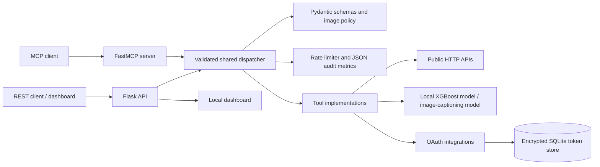

# Architecture

Every exposed tool uses `security.observability.execute_tool`, which validates its
arguments, applies an in-process per-tool rate limit, and records an argument hash,
latency, success/failure status, and timestamp as structured JSON. Raw arguments
and OAuth tokens are not written to the audit log. The Flask application binds to
loopback by default.

Fraud model artifacts and datasets are intentionally not bundled. Fraud model
training expects `amount`, `hour`, `foreign_country`, and `is_new_device`; the
binary target uses `0` for legitimate and `1` for fraud. Image captioning uses
the pretrained BLIP model, downloaded on first use or loaded from the local model
directory configured by `IMAGE_CAPTION_MODEL`.

OAuth tokens are encrypted with Fernet before storage in SQLite. The encryption
key, Flask session key, and provider credentials must be supplied through
environment variables. Google requests only the read-only Calendar events scope.
Notion access is constrained by the workspace and pages granted during consent.